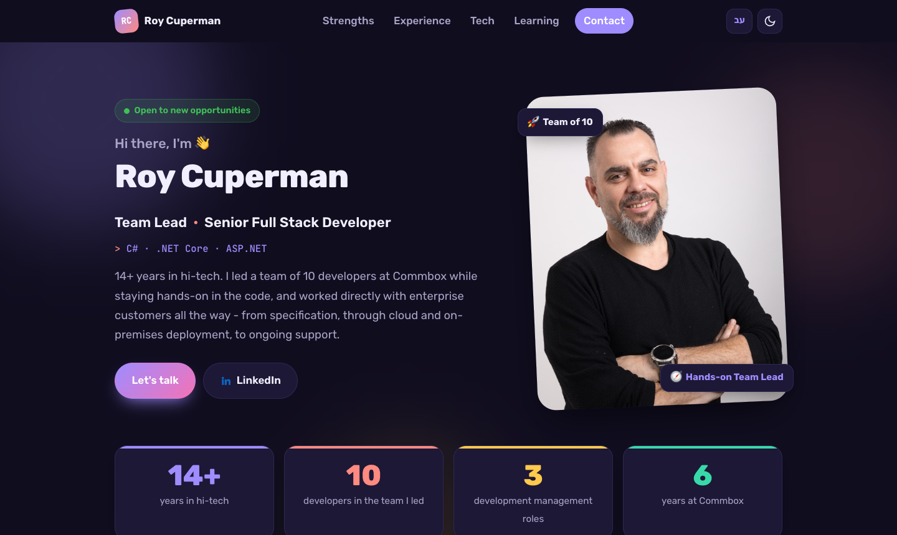
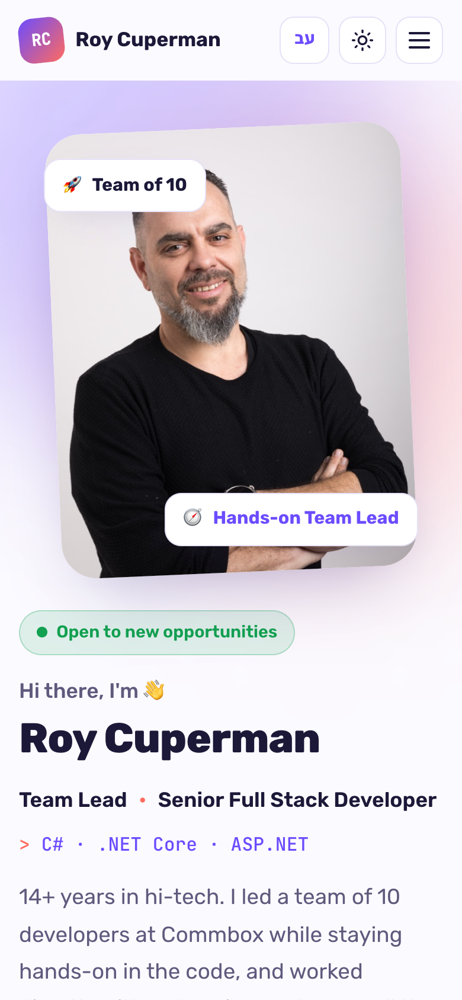
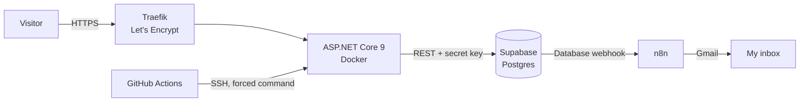

# Roy Cuperman - Job Landing Page

[](https://github.com/coperman12/job-landing-page/actions/workflows/deploy.yml)

A personal landing page for my job search (Team Lead / Senior .NET Developer), with a contact form that stores messages in Supabase and notifies me by email.

**Live:** https://roylp.copermans.tech &nbsp;·&nbsp; Hebrew: https://roylp.copermans.tech/?lang=he

<p>
  
  
</p>

## Features

- **English and Hebrew** - one click switches the language and the layout direction (LTR / RTL); `?lang=he` opens Hebrew directly
- **Dark and light mode** - follows the system, remembers the visitor's choice
- **Contact form** - validated in the browser and again on the server, saved to Postgres (Supabase)
- **Email notification** - a Supabase database webhook triggers an n8n workflow that emails me, with Reply-To set to the visitor
- **Responsive and accessible** - desktop to mobile, keyboard focus styles, ARIA labels, reduced-motion support

## Tech stack

| Layer | Technology |
|---|---|
| Front end | HTML, CSS (custom properties, logical properties for RTL), TypeScript (ES modules, no framework) |
| Back end | ASP.NET Core 9 minimal API (C#) |
| Database | Supabase (Postgres, REST API, Row Level Security) |
| Automation | n8n (self-hosted), Gmail |
| Hosting | Docker on a VPS, behind Traefik with Let's Encrypt |
| CI/CD | GitHub Actions |

## Architecture



The browser never talks to Supabase directly. Only the server holds the secret key.

## Security

- **Content Security Policy** - only the site's own scripts run; the inline theme script is allowed by a SHA-256 hash computed at startup
- **Rate limiting** - 5 messages per IP per 10 minutes (the real visitor IP is taken from Traefik's `X-Forwarded-For`)
- **Spam** - a hidden honeypot field, plus server-side validation of every field
- **Database** - RLS enabled with no public policies; only the server's `service_role` can read or write
- **Headers** - HSTS, `X-Frame-Options: DENY`, `nosniff`, a strict Referrer and Permissions policy
- **Only public files are served** - the server code and the SQL scripts are never reachable over HTTP
- **Deploy key** - the CI key can only run the deploy script on the server (no shell), and the build always uses the server's own `docker-compose.yml`

## Project structure

```
index.html              The page (English text, with data-i18n keys)
styles/                 variables, base, layout, components, animations
scripts/src/            TypeScript: i18n (en/he dictionary), theme, contact form, animations
scripts/dist/           Compiled JS - committed, so the server needs no Node
images/                 Profile photo
server/                 ASP.NET Core: serves the page and POST /api/contact
database/schema.sql     The contact_messages table, RLS and grants
Dockerfile              Multi-stage build: .NET SDK -> aspnet runtime + public files
deploy/                 docker-compose (Traefik labels), receive.sh, deploy.sh, env.example
.github/workflows/      Build checks and deploy on push to main
```

## Running locally

Requirements: .NET 9 SDK and Node.js (only for compiling TypeScript).

1. Create the table: run `database/schema.sql` in the Supabase SQL editor.
2. Store the Supabase settings as user-secrets (outside the repo):
   ```bash
   cd server
   dotnet user-secrets set "Supabase:Url" "https://<project-ref>.supabase.co"
   dotnet user-secrets set "Supabase:SecretKey" "<secret key>"
   ```
3. Run the server: `dotnet run` (from `server/`), then open http://localhost:5080
4. After changing TypeScript, compile from the repo root: `npm run build:ts`

## Deployment

Every push to `main` runs the pipeline:

1. **build** - compiles the TypeScript and fails if `scripts/dist` is out of date, then builds the .NET server
2. **deploy** - sends the tracked files to the server over SSH; the server rebuilds the image and restarts the container, then the live `/health` endpoint is checked

Pull requests run the build checks only. If the build fails on the server, the previous version keeps running.

Server setup, once: create `/docker/landing/.env` from `deploy/env.example` and run `./deploy/deploy.sh` from the Mac. The same script deploys by hand and is the only way to update `docker-compose.yml` and `receive.sh` on the server.

---

Built with ASP.NET Core, TypeScript & Supabase.
